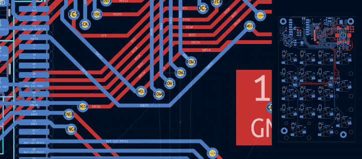

# PCB Timelapse

> [!WARNING]
> **AI-written code.** PCB Timelapse was written almost entirely by Claude, working from my design direction, feedback and bug reports. I've used and tested it on Windows with KiCad 10, but other setups are less tested, so expect rough edges. Treat it like any third-party code: keep backups of your projects and report problems in Issues.

Record your KiCad PCB layout work and turn it into a timelapse video. It records two streams:

- **View:** what you see in the editor, including where you're zoomed in and which layer you're working on.
- **Board:** the whole board, re-drawn cleanly from snapshots with the layers and look you choose at render time. There's no ratsnest, cursor or selection highlight.

You can render them separately, side by side, or stacked.

Recording only runs while the PCB Editor is the window you're using. Alt-tab, sleep or the lock screen pause it, and that time doesn't count.

   

   *Left: the editor view while routing. Right: the board video, which follows the copper layer being worked on (2× speed).*

<details>
<summary>▶ Full-quality video (real speed)</summary>

https://github.com/user-attachments/assets/558e34e8-116a-42f5-b8ec-85543dcca87b

<sub>ps. don't judge my board</sub>

</details>


## Requirements

- KiCad 7, 8, 9 or 10. The recorder uses KiCad's Python action-plugin API, which KiCad 11 is expected to remove.
- For rendering:
  - a separate Python 3 install (KiCad's bundled Python is not used) with `pip install pymupdf pillow`
  - [ffmpeg](https://ffmpeg.org/) on your PATH
- Recording itself has no extra requirements.

Tested on Windows. Linux and macOS should work, but are less tested; lock-screen detection is Windows-only.

## Install

**KiCad Plugin and Content Manager:** search for *PCB Timelapse*, once it's listed.

**Manually:** download `pcb-timelapse-<version>-manual.zip` from [Releases](https://github.com/MrJamington/pcb-timelapse/releases) and unzip it into your plugins folder (in the PCB Editor, **Tools → External Plugins → Open Plugin Directory**), then **Tools → External Plugins → Refresh Plugins**.

Three buttons appear on the toolbar:

| Button | What it does |
|---|---|
| Board with red dot | Opens the PCB Timelapse window. The dot is bright red while recording, and blinks while capturing |
| Board with orange pause | Pauses and resumes recording |
| Board with blue play | Opens the render dialog |

## Recording

Save the board once, then click the record button. The **PCB Timelapse** window has:

- **Start / Pause / Stop.** Whichever doesn't apply is greyed out. Start and Stop close the window.
- **New recording** or **Continue** an earlier one. Continuing picks up its clock and frame numbering, so the result renders as one recording.
- **Options**, remembered between sessions:
  - auto-start: off, boards with *auto-record* ticked, or every board you open
  - capture the whole editor (UI shown or cropped when rendering) or the drawing area only
  - screenshot interval
  - where board snapshots come from (below)
- **Recordings:** this board's recordings with length, frame count and size on disk. Recordings that have been rendered are marked.
  - Tick them by hand, or with *Tick ones under N frames / minutes*.
  - Then delete them, clear render caches, open the folders, or start a render.

Files go next to your board:

```
<board folder>/pcb_timelapse/
    20261024-153000/      one recording (screenshots, board snapshots, log)
    renders/
        20261024-153000/  its videos; kept even if the recording is deleted
```

Your `.kicad_pcb` is never modified.

### Board snapshots and KiCad's autosave

By default (*safe* mode) the board stream only uses files KiCad wrote itself: your saves, and KiCad's autosave file. The plugin never reads the board out of KiCad's memory, so it can't interfere with an operation in progress.

For this to work, set **Preferences → Common → Project Backup** to:
- **Format: Zip archive.** The *Incremental* format writes no autosave file.
- **Location: Project directory.**

In KiCad 10, autosave runs about 5 s after you stop editing. You can change that with `system.local_history_debounce` (seconds) in `kicad_common.json`; it isn't in the Preferences dialog.

*Live* mode also snapshots the board straight from KiCad's memory every few seconds. That gives a finer-grained board video, but a snapshot can land mid-drag and crash KiCad.

### Ignoring recordings in git

Recordings can get large. To ignore them but keep the rendered videos:

```gitignore
**/pcb_timelapse/**
!**/pcb_timelapse/**/
!**/pcb_timelapse/renders/**
```

To ignore everything, use `**/pcb_timelapse/`.

## Rendering

Click the render button, or **Render…** in the PCB Timelapse window.

- Tick one or more recordings, then join them into one continuous video or render each separately.
- Tick, untick and reorder board layers. The top of the list is drawn on top.
- Choose the look: holes, vias, board fill, outline, glow, colours, video size and layout.

Rendering runs in the background, so KiCad stays usable, and settings are remembered.

| Output | Contents |
|---|---|
| `view.mp4` | The editor view, cropped to the drawing area or with the whole UI |
| `board.mp4` | The whole board. Follows your active layer, and matches the view video's timing by default |
| `combined.mp4` | Both together: side by side, board below, or auto (picks whichever suits the board's shape) |

The first render exports every board layer and is the slow one. Re-renders with different layers or colours reuse that work.

### Command line

```
python render.py "<board folder>/pcb_timelapse/20261024-153000" --combined
python render.py REC1 REC2 REC3 --combined           # joined into one video
python render.py REC1 REC2 --separate                # one video set each
python render.py REC --hide B.Silkscreen --holes cyan --vias kicad --view-ui full
```

| Option | What it does |
|---|---|
| `--layers` | Board stack, bottom → top. Default: B.Silkscreen, B.Cu, inner layers, F.Cu, F.Silkscreen, Edge.Cuts |
| `--hide` | Drop layers from the stack |
| `--opacity LAYER=x` | Fade a layer (repeatable) |
| `--theme NAME` | KiCad colour theme (default: your editor theme) |
| `--holes` | Pad and mounting holes: `kicad` (editor look: gold plated holes, cyan-outlined non-plated), `dark`, `board` (board colour), or a `white` / `cyan` / `gold` ring |
| `--vias` | Via holes, same choices |
| `--via-colour layer\|plot` | Via copper in each copper layer's colour like the editor (default), or KiCad's plotted via colour |
| `--crop edge\|all` | Frame the board outline, or everything on the final board |
| `--board-fill auto\|none\|#hex` | Shade the area inside the board outline |
| `--outline` | Board outline thickness in px (default 3) |
| `--glow`, `--saturation` | Soft glow around copper, and colour boost |
| `--board-size` | e.g. `1920x1080`; `auto` picks landscape or portrait to suit the board |
| `--fps`, `--hold` | Playback speed, and how long to hold the last frame |
| `--no-follow-active` | Fixed layer order instead of raising the copper layer you were last working on |
| `--inactive-opacity` | Fade layers other than the active one, e.g. `0.45`, like KiCad's high-contrast mode |
| `--no-sync` | Board video gets one frame per snapshot, instead of matching the view timeline |
| `--combined`, `--layout auto\|side\|below` | Also write a combined video, and its layout |
| `--view-ui canvas\|full` | View video: drawing area only, or the whole editor UI |
| `--only view\|board` | Render one stream only |
| `--out DIR` | Output folder (default `renders/<recording>/`) |

## Troubleshooting

- **The view video is black or shows the wrong area:** set Capture to the other mode in the PCB Timelapse window.
- **The board video doesn't change:** check the Project Backup settings above, or save more often.
- **The render dialog can't find Python:** run `pip install pymupdf pillow` in your normal Python, or paste the path to `python.exe` into the dialog.
- **Clicking a button marks the board as modified (`*`):** this was a KiCad behaviour with old-style plugins. PCB Timelapse intercepts its own buttons to avoid it, but if KiCad changes its toolbar, the `*` may come back. It's harmless.

## Contributing

Issues and pull requests are welcome. The plugin lives in `pcb_timelapse/`; release packaging is in `release/` (see `release/RELEASING.md`).

## Licence

GPL-3.0-or-later, see `LICENSE`. Rendering uses [PyMuPDF](https://pymupdf.readthedocs.io/) (AGPL-3.0) and [Pillow](https://python-pillow.org/), installed separately.
